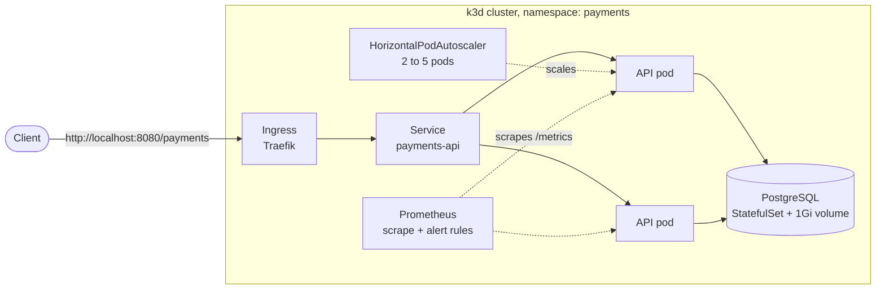

# Self-Healing Payments API on Kubernetes


A small payments API (Flask + PostgreSQL) running on Kubernetes, plus **five failure drills** that break it on purpose and measure how it recovers.

The Kubernetes building blocks are the everyday ones: Deployments, Services, ConfigMaps, Secrets, a StatefulSet with a persistent volume, health probes, an autoscaler, an ingress and Prometheus monitoring. The drills are what this project is about: each one breaks something and records what happened.

## Architecture



| Component | Kubernetes objects | What it does |
| --- | --- | --- |
| Payments API | Deployment (2 replicas), Service, Ingress | Create and list payments. Exposes `/health`, `/ready` and `/metrics` inside the cluster |
| Configuration | ConfigMap, Secret | Settings in the ConfigMap; the database password in a Secret created at deploy time, never committed |
| Database | StatefulSet, headless Service, PersistentVolumeClaim | PostgreSQL whose data survives pod restarts |
| Self-healing | Liveness and readiness probes, rolling-update settings | Restart stuck containers; keep traffic away from pods that are not ready |
| Scaling | HorizontalPodAutoscaler | Adds pods when CPU goes above 50% of the request |
| Monitoring | Prometheus Deployment, RBAC, ConfigMap | Scrapes request rate, errors and latency; 3 alert rules |
| CI | GitHub Actions | Unit tests, image build, manifest validation, then a real cluster and all five drills |

## Failure drills

`python scripts/drills.py all` runs all five. While each drill runs, a prober calls the API five times a second and counts failed requests.

| Drill | What it breaks | What should happen |
| --- | --- | --- |
| Pod crash | Deletes an API pod | The Deployment starts a replacement; the other pod keeps serving |
| Hung app | Makes one pod stop responding (`/admin/hang`) | The liveness probe fails 3 times and Kubernetes restarts the container |
| Faulty release | Releases a version whose readiness check always fails | `maxUnavailable: 0` keeps the old pods serving; the release is marked failed after 60s; `kubectl rollout undo` restores it |
| Traffic spike | Runs 4 load-generator pods for 2 minutes | The autoscaler adds pods (up to 5), then removes them once load drops |
| Database restart | Deletes the PostgreSQL pod | It comes back on the same volume with no payments lost |

### My results

<!-- Run `python scripts/drills.py all`, then paste the table from drills/results.md here. -->

_Not run yet. Results from `drills/results.md` go here._

_After running the drills, write a postmortem for one of them in `docs/postmortem.md` using [the template](docs/postmortem-template.md), and link it here._

## Run it

You need Docker, [k3d](https://k3d.io) and kubectl. Full step-by-step instructions for Windows, including how to push this repo to GitHub, are in [docs/getting-started.md](docs/getting-started.md).

```bash
python scripts/cluster.py up        # create the cluster, build the image, deploy everything
python scripts/drills.py all        # run the five failure drills (about 8 minutes)
python scripts/cluster.py status    # see pods, services, autoscaler
python scripts/cluster.py down      # delete the cluster
```

No Kubernetes on your machine? You have two other options:

- **GitHub Actions:** every push to `main` builds a real k3d cluster, deploys, and runs all five drills. The results appear on the run's summary page.
- **GitHub Codespaces:** open the repo in a Codespace (Code > Codespaces). Docker, kubectl and k3d are installed automatically; then run the commands above.

## Use the API

```bash
# create a payment (the Idempotency-Key stops the same payment being made twice)
curl -X POST http://localhost:8080/payments \
  -H "Content-Type: application/json" \
  -H "Idempotency-Key: order-1001" \
  -d '{"amount": "25.50", "currency": "SGD", "description": "coffee"}'

# list payments (total count + the 20 newest)
curl http://localhost:8080/payments

# one payment
curl http://localhost:8080/payments/1
```

On Windows PowerShell:

```powershell
Invoke-RestMethod -Method Post -Uri http://localhost:8080/payments -ContentType "application/json" -Body '{"amount": "25.50", "currency": "SGD", "description": "coffee"}'
Invoke-RestMethod http://localhost:8080/payments
```

Rules: `amount` greater than 0, at most 2 decimal places, up to 100000.00; `currency` one of SGD, USD, EUR, INR, GBP; `description` up to 140 characters.

## Monitoring

```bash
kubectl port-forward -n payments svc/prometheus 9090:9090
```

Open http://localhost:9090. Useful queries:

| Question | PromQL |
| --- | --- |
| Requests per second, per pod | `sum by (pod) (rate(http_requests_total{job="payments-api"}[1m]))` |
| Share of requests that succeed | `sum(rate(http_requests_total{job="payments-api",status!~"5.."}[5m])) / sum(rate(http_requests_total{job="payments-api"}[5m]))` |
| 95th percentile latency | `histogram_quantile(0.95, sum by (le) (rate(http_request_duration_seconds_bucket{job="payments-api"}[5m])))` |
| Is each pod being scraped? | `up{job="payments-api"}` |

Alert rules (Alerts tab): `PaymentsHighErrorRate` (more than 5% of requests failing for 1 minute), `PaymentsApiPodDown` and `PaymentsApiRestarted`. What to do for each is in [docs/runbook.md](docs/runbook.md).

## Design decisions

- **Money is stored as whole cents** (an integer), never a float, so amounts never pick up rounding errors.
- **Idempotency keys**: if a client retries `POST /payments` with the same `Idempotency-Key`, it gets the original payment back instead of being charged twice.
- **Liveness does not check the database; readiness does.** If the database is down, restarting the API would not help, so liveness only asks "is the process stuck?" Readiness takes a pod out of traffic while it cannot reach the database.
- **`maxUnavailable: 0`** during releases: an old pod is only removed once a new one is ready, so a broken release cannot take the service down.
- **Only `/payments` is exposed** through the ingress. `/admin`, `/health`, `/ready` and `/metrics` are reachable only inside the cluster.
- **The database password is generated at deploy time** and stored in a Kubernetes Secret, so it never appears in Git.
- **A new database connection per request**: slower than a connection pool, but the API recovers on its own after the database restarts.
- **The "fraud check" is simulated**: it spends a little CPU on purpose so a load test makes the autoscaler react.

## Project structure

```
app/                     Flask API, Dockerfile, tests
  main.py                endpoints, validation, metrics, health checks
  store.py               PostgreSQL store + in-memory store for tests
  tests/                 22 API tests + 5 PostgreSQL tests
k8s/                     Kubernetes manifests, applied in number order
  monitoring/            Prometheus with alert rules
  drills/load-test.yaml  load generator used by the traffic-spike drill
scripts/
  cluster.py             up / status / down
  drills.py              the five failure drills
docs/                    getting started, runbook, postmortem template
drills/results.md        drill results (created when you run the drills)
.github/workflows/ci.yml CI pipeline
.devcontainer/           GitHub Codespaces setup
```

## Run the tests without Kubernetes

```bash
pip install -r app/requirements.txt -r app/requirements-dev.txt
pytest -v app/tests
```

The PostgreSQL tests are skipped unless `TEST_DB_HOST` is set; CI runs them against a real database.
